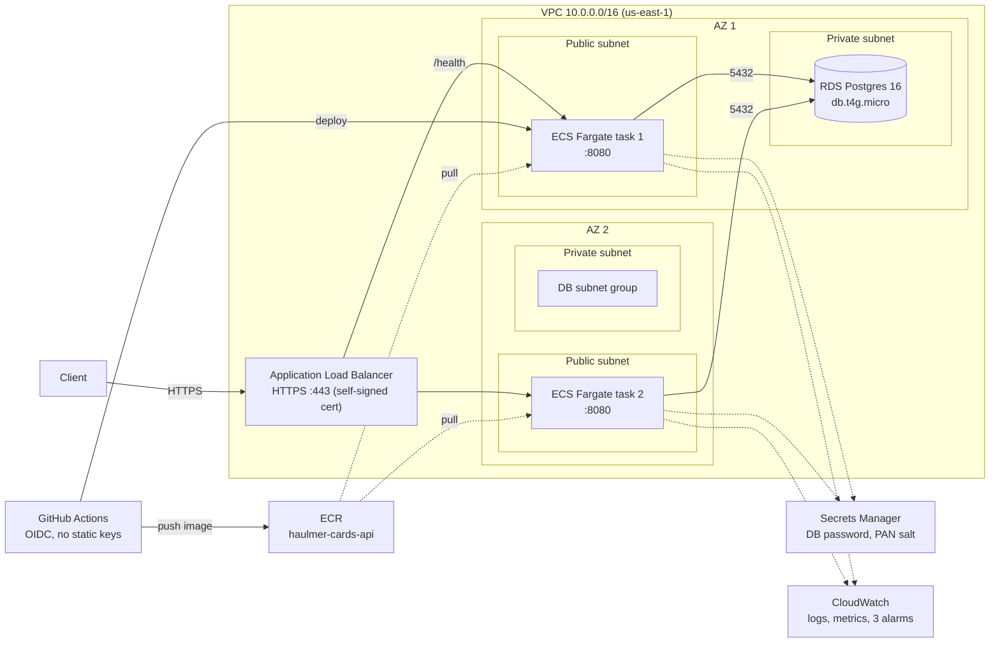

# Cards API

REST API in Go to create and query credit cards. Hexagonal architecture, Postgres storage, built to run on AWS.

## Architecture

Clients reach the API through an HTTPS Application Load Balancer that spreads traffic across two ECS Fargate tasks, one per availability zone, all talking to one RDS Postgres database.



> **Deviation from the brief:** the tasks run in public subnets (with a public IP) instead of private ones, to avoid the cost of a NAT Gateway. Security groups chain ALB, tasks and database so only the ALB reaches the tasks on 8080 and only the tasks reach the database on 5432. The database stays in private subnets. Moving the tasks to private subnets needs a NAT Gateway or VPC endpoints for ECR, S3, Logs and Secrets Manager.

Each instance is stateless, so any replica can serve any request. `GET /health` returns the identifier of the instance that answered, which makes the load distribution visible.

### Evidence

Load distribution measured against the deployed ALB is in [`evidence/aws/`](evidence/aws/): 3000 requests to `GET /health` with `hey` (all `200`), plus a per-instance count taken while the load ran. The two tasks answered about half each (154 and 146 of 300).

### Code layout

Hexagonal layers with a CQRS-lite split. Dependencies point inwards: `domain` imports nothing internal, `app` depends on `domain`, `ports` on `app`, and only `service` wires everything.

```text
app/api/openapi/cards.yml    HTTP contract (source of truth)
app/cmd/api/                 entry point
app/internal/
├── domain/              Card entity, errors, repository interface
├── app/                 use cases: command/ (create) and query/ (get, list, search)
├── ports/               HTTP entry points: Chi router over the generated OpenAPI server
│   └── middleware/      request id, request log and metrics
├── adapters/
│   ├── repository/      Postgres via GORM
│   ├── security/        HMAC hashing of the PAN
│   └── secrets/         AWS Secrets Manager client
├── config/              environment loading and validation
├── logging/             slog logger with masking of sensitive keys
└── service/             composition root
```

The HTTP server code is generated from the contract: `./scripts/openapi-http.sh cards internal/ports ports` (or `make openapi_http`). Never edit the `*.gen.go` files.

## Endpoints

The full contract is in [`app/api/openapi/cards.yml`](app/api/openapi/cards.yml).

| Method | Path | Purpose |
| :----- | :--- | :------ |
| `POST` | `/cards` | Create a card; requires the `Idempotency-Key` header |
| `GET` | `/cards/{id}` | Get a card by id |
| `GET` | `/cards?limit=&cursor=` | List cards with cursor pagination |
| `GET` | `/cards:search?last4=` | Search by last 4 digits; optional `brand`, `cardHolderName` (prefix), `expMonth`, `expYear`, `limit`, `cursor` |
| `GET` | `/health` | Liveness check that identifies the serving instance |

Example:

```bash
curl -X POST localhost:8080/cards \
  -H 'Content-Type: application/json' \
  -H 'Idempotency-Key: 6f1c2a9e-4d1b-4f0e-9a52-3c2b7d8e1a10' \
  -d '{"pan":"4111111111111111","cardHolderName":"Ada Lovelace","expMonth":12,"expYear":2030}'
```

Repeating a request with the same `Idempotency-Key` returns the card created the first time (`201` with the same body) instead of creating another one, so a client can retry safely after a timeout. The key is stored with the card and never expires. Only the key is compared: reusing it with a different card returns the original card.

The PAN accepts spaces and hyphens (`4111 1111 1111 1111`); they are removed before validation and hashing. It must be 12 to 19 digits and pass the Luhn check, and the expiry must not be in the past (a card is valid through the end of its expiry month).

Responses never include the PAN or its hash, only `last4`, `brand`, holder name, expiry and timestamps.

Errors share one shape, `{"slug": "...", "message": "...", "requestId": "..."}`:

| Status | Meaning |
| :----- | :------ |
| `400` | Malformed request, invalid query parameter or missing or blank `Idempotency-Key` |
| `404` | Card not found |
| `409` | A card with the same PAN already exists |
| `413` | Body larger than 1 MiB |
| `422` | Business rule violated |
| `500` | Unexpected error, with a fixed message |

## Run locally

Everything application-related lives in [`app/`](app/), so run these commands from there (`cd app`). Requirements: Go (see `app/go.mod`) and a Postgres database. Docker is the quickest way to get one:

```bash
docker compose up -d --wait db

APP_ENV=local DB_HOST=localhost DB_NAME=cards DB_USER=postgres DB_PASSWORD=dev \
  DB_SSLMODE=disable PAN_SALT=any-local-secret go run ./cmd/api
```

The schema is created on startup. The API listens on `PORT` (default `8080`).

`make run` does the same in one step (starts the database and the API with a local configuration, for example to try it from Postman) and `make down` removes the database and its data.

### Configuration

All settings come from environment variables, read once at startup. Missing required values stop the process.

| Variable | Required | Default | Purpose |
| :------- | :------- | :------ | :------ |
| `APP_ENV` | yes | | `local` reads secrets from the environment; `cloud` reads them from Secrets Manager |
| `DB_HOST`, `DB_NAME`, `DB_USER` | yes | | Database connection |
| `DB_PORT` | no | `5432` | |
| `DB_SSLMODE` | no | `require` | Use `disable` for a local database |
| `DB_PASSWORD`, `PAN_SALT` | `local` only | | Password and HMAC salt in plain text |
| `AWS_REGION`, `DB_PASSWORD_SECRET_ID`, `PAN_SALT_SECRET_ID` | `cloud` only | | Where to read the secrets from |
| `PORT` | no | `8080` | HTTP port |
| `POD_NAME` | no | hostname | Instance identifier returned by `/health` |
| `LOG_LEVEL` | no | `info` | `debug`, `info`, `warn` or `error` |
| `LOG_FORMAT` | no | `text` locally, `json` in `cloud` | `text` or `json` |
| `RUN_MIGRATIONS` | no | `true` | Set to `false` when the schema is managed outside the app |

### Tests

```bash
go build ./... && go vet ./... && go test ./...
go test -tags integration ./internal/adapters/repository/   # needs Docker
```

`make demo` (or `./scripts/demo.sh`, from `app/`) is an end-to-end smoke test: it starts a throwaway Postgres container on port 5432 (stopping any container already publishing that port), builds and runs the API against it, exercises the main flows with `curl` (including an `Idempotency-Key` replay), and tears everything down on exit. It needs Docker and prints `RESULT: PASS` or `RESULT: FAIL`.

## Deploy on AWS

The infrastructure is Terraform under [`infra/`](infra/README.md), one state per component. The one-time setup (state bucket, GitHub roles, repository variables) and the pipeline are described there. Apply the stacks in this order, each with `terraform init && terraform apply` from `infra/<component>/prod`:

`ecr` → push the first image → `network` → `secrets` → `rds` → `alb` → `ecs` → `cloudwatch`

First image, from `app/` (the `ecs` stack starts from the `latest` tag):

```bash
REGISTRY=<account-id>.dkr.ecr.us-east-1.amazonaws.com
aws ecr get-login-password --region us-east-1 | docker login --username AWS --password-stdin $REGISTRY
docker build -t $REGISTRY/haulmer-cards-api:latest .
docker push $REGISTRY/haulmer-cards-api:latest
```

After that, every push to `main` that changes `app/` builds the image, pushes it to ECR and rolls the ECS service ([`.github/workflows/ci.yml`](.github/workflows/ci.yml)).

The certificate is self-signed, so `curl` needs `-k`. `<alb>` is the `dns_name` output of the `alb` stack:

```bash
curl -k https://<alb>/health

curl -k -X POST https://<alb>/cards \
  -H 'Content-Type: application/json' \
  -H "Idempotency-Key: $(uuidgen)" \
  -d '{"pan":"4111111111111111","cardHolderName":"Ada Lovelace","expMonth":12,"expYear":2030}'

curl -k 'https://<alb>/cards:search?last4=1111'
```

A Postman collection with all endpoints is in [`app/api/postman/`](app/api/postman/cards-api.postman_collection.json).

The ALB, RDS and Fargate tasks bill by the hour. Run `terraform destroy` in reverse order when you are done testing; `ecr`, `iam` and `bootstrap` can stay.

## Observability

- **Logs:** structured `slog` to stdout, so the container log driver ships them to CloudWatch. Every line carries `service`, `env` and `instance`; values under sensitive keys (`pan`, `pan_hash`, `password`, `token`, ...) are masked. GORM logs go through the same logger and never print bound query values.
- **Request log and metrics:** one line per request with method, route, path, status and latency. In JSON format it doubles as a CloudWatch [Embedded Metric Format](https://docs.aws.amazon.com/AmazonCloudWatch/latest/monitoring/CloudWatch_Embedded_Metric_Format.html) record, so request count and latency are extracted as metrics without an extra SDK. Metrics are only useful with `LOG_FORMAT=json`.
- **Tracing a request:** every response carries an `X-Request-Id` header, and errors repeat it as `requestId`. A client may send its own (1 to 64 characters of letters, digits, `.`, `_` or `-`); otherwise one is generated. Searching the logs by that id, or by the card id in `path`, finds the request.

## Security notes

- The PAN is never stored in clear text or returned. Only `last4`, `brand` and `panHash` (`HMAC-SHA256(pan, salt)`) are kept, and `panHash` is used to reject duplicates.
- Storing only the one-way HMAC is the chosen way to store the PAN securely: no endpoint needs the full PAN back, and the key is kept outside the database, so a database leak alone does not allow guessing PANs against the hashes. Recovering the PAN would need reversible storage, described as improvement C13 in [`odd/requirements-and-improvements.md`](odd/requirements-and-improvements.md).
- The CVV is never requested or stored.
- In `cloud`, the database password and the salt come from AWS Secrets Manager; a missing or blank secret stops startup.

## Not built yet

| Item | State |
| :--- | :---- |
| Brand detection for Discover, Diners Club and JCB | Only Visa, Mastercard and American Express are detected; any other PAN is `unknown` |
| Reversible PAN storage | Not needed by any endpoint; proposal in `odd/requirements-and-improvements.md` (C13) |
| Tasks in private subnets | Tasks run in public subnets to avoid a NAT Gateway; see the deviation note under Architecture |
| Trusted TLS certificate | The ALB uses a self-signed certificate; a real domain and an ACM certificate would replace it |
| Narrow permissions for the apply role | The Terraform apply role has `AdministratorAccess`; it should be scoped to the services in use |
| Alarm notifications | The three CloudWatch alarms exist but notify no one (no SNS topic) |

## How this was built

The project was developed with an AI coding agent, task by task, under human direction. The human sets scope and decisions; the agent explores, proposes, implements and verifies, and every work unit was reviewed before commit. The working documents are kept in [`odd/`](odd/):

- [`odd/plans/cards-api.md`](odd/plans/cards-api.md): design decisions.
- [`odd/tasks/cards-api.md`](odd/tasks/cards-api.md): task list with the commit of each work unit.
- [`odd/requirements-and-improvements.md`](odd/requirements-and-improvements.md): what was required, what was added on our own, and ideas still open.
