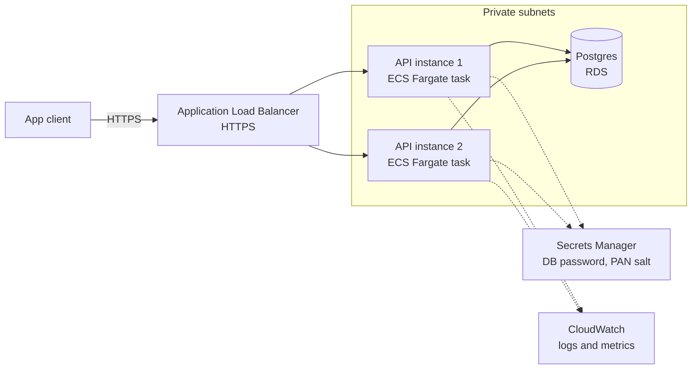

# Cards API

REST API in Go to create and query credit cards. Hexagonal architecture, Postgres storage, built to run on AWS.

## Architecture

Target deployment: clients reach the API through an HTTPS load balancer that spreads traffic across replicas running in private subnets, all talking to one Postgres database.



> **Status:** the application is built and runs locally. The AWS infrastructure above is the target design and is **not deployed yet** (see [Not built yet](#not-built-yet)).

Each instance is stateless, so any replica can serve any request. `GET /health` returns the identifier of the instance that answered, which makes the load distribution visible.

### Code layout

Hexagonal layers with a CQRS-lite split. Dependencies point inwards: `domain` imports nothing internal, `app` depends on `domain`, `ports` on `app`, and only `service` wires everything.

```text
api/openapi/cards.yml    HTTP contract (source of truth)
cmd/api/                 entry point
internal/
├── domain/              Card entity, errors, repository interface
├── app/                 use cases: command/ (create) and query/ (get, list, search)
├── ports/               HTTP entry points: Chi router over the generated OpenAPI server
│   └── middleware/      request id, request log and metrics
├── adapters/
│   ├── repository/      Postgres via GORM
│   ├── security/        HMAC hashing of the PAN
│   └── secrets/         AWS Secrets Manager client
├── config/              environment loading and validation
├── logging/             slog logger with masking of sensitive keys
└── service/             composition root
```

The HTTP server code is generated from the contract: `./scripts/openapi-http.sh cards internal/ports ports` (or `make openapi_http`). Never edit the `*.gen.go` files.

## Endpoints

The full contract is in [`api/openapi/cards.yml`](api/openapi/cards.yml).

| Method | Path | Purpose |
| :----- | :--- | :------ |
| `POST` | `/cards` | Create a card |
| `GET` | `/cards/{id}` | Get a card by id |
| `GET` | `/cards?limit=&cursor=` | List cards with cursor pagination |
| `GET` | `/cards:search?last4=` | Search by last 4 digits; optional `brand`, `cardHolderName` (prefix), `expMonth`, `expYear`, `limit`, `cursor` |
| `GET` | `/health` | Liveness check that identifies the serving instance |

Example:

```bash
curl -X POST localhost:8080/cards \
  -H 'Content-Type: application/json' \
  -d '{"pan":"4111111111111111","cardHolderName":"Ada Lovelace","expMonth":12,"expYear":2030}'
```

Responses never include the PAN or its hash, only `last4`, `brand`, holder name, expiry and timestamps.

Errors share one shape, `{"slug": "...", "message": "...", "requestId": "..."}`:

| Status | Meaning |
| :----- | :------ |
| `400` | Malformed request or invalid query parameter |
| `404` | Card not found |
| `409` | A card with the same PAN already exists |
| `413` | Body larger than 1 MiB |
| `422` | Business rule violated |
| `500` | Unexpected error, with a fixed message |

## Run locally

Requirements: Go (see `go.mod`) and a Postgres database. Docker is the quickest way to get one:

```bash
docker run -d --name cards-db -e POSTGRES_PASSWORD=dev -e POSTGRES_DB=cards -p 5432:5432 postgres:16

APP_ENV=local DB_HOST=localhost DB_NAME=cards DB_USER=postgres DB_PASSWORD=dev \
  DB_SSLMODE=disable PAN_SALT=any-local-secret go run ./cmd/api
```

The schema is created on startup. The API listens on `PORT` (default `8080`).

### Configuration

All settings come from environment variables, read once at startup. Missing required values stop the process.

| Variable | Required | Default | Purpose |
| :------- | :------- | :------ | :------ |
| `APP_ENV` | yes | | `local` reads secrets from the environment; `cloud` reads them from Secrets Manager |
| `DB_HOST`, `DB_NAME`, `DB_USER` | yes | | Database connection |
| `DB_PORT` | no | `5432` | |
| `DB_SSLMODE` | no | `require` | Use `disable` for a local database |
| `DB_PASSWORD`, `PAN_SALT` | `local` only | | Password and HMAC salt in plain text |
| `AWS_REGION`, `DB_PASSWORD_SECRET_ID`, `PAN_SALT_SECRET_ID` | `cloud` only | | Where to read the secrets from |
| `PORT` | no | `8080` | HTTP port |
| `POD_NAME` | no | hostname | Instance identifier returned by `/health` |
| `LOG_LEVEL` | no | `info` | `debug`, `info`, `warn` or `error` |
| `LOG_FORMAT` | no | `text` locally, `json` in `cloud` | `text` or `json` |
| `RUN_MIGRATIONS` | no | `true` | Set to `false` when the schema is managed outside the app |

### Tests

```bash
go build ./... && go vet ./... && go test ./...
go test -tags integration ./internal/adapters/repository/   # needs Docker
```

## Observability

- **Logs:** structured `slog` to stdout, so the container log driver ships them to CloudWatch. Every line carries `service`, `env` and `instance`; values under sensitive keys (`pan`, `pan_hash`, `password`, `token`, ...) are masked. GORM logs go through the same logger and never print bound query values.
- **Request log and metrics:** one line per request with method, route, path, status and latency. In JSON format it doubles as a CloudWatch [Embedded Metric Format](https://docs.aws.amazon.com/AmazonCloudWatch/latest/monitoring/CloudWatch_Embedded_Metric_Format.html) record, so request count and latency are extracted as metrics without an extra SDK. Metrics are only useful with `LOG_FORMAT=json`.
- **Tracing a request:** every response carries an `X-Request-Id` header, and errors repeat it as `requestId`. A client may send its own (1 to 64 characters of letters, digits, `.`, `_` or `-`); otherwise one is generated. Searching the logs by that id, or by the card id in `path`, finds the request.

## Security notes

- The PAN is never stored in clear text or returned. Only `last4`, `brand` and `panHash` (`HMAC-SHA256(pan, salt)`) are kept, and `panHash` is used to reject duplicates.
- The CVV is never requested or stored.
- In `cloud`, the database password and the salt come from AWS Secrets Manager; a missing or blank secret stops startup.

## Not built yet

| Item | State |
| :--- | :---- |
| Luhn and expiry validation | Signatures only in `domain`; any PAN and any expiry are accepted today |
| Brand detection | Signature only; `brand` is always `unknown` |
| Reversible PAN storage | Under research; only the one-way hash exists |
| Idempotency by `Idempotency-Key` | Draft in the plan |
| Dockerfile, ECS Fargate service, load balancer, RDS | Target design, not deployed |

## How this was built

The project was developed with an AI coding agent, task by task, under human direction. The human sets scope and decisions; the agent explores, proposes, implements and verifies, and every work unit was reviewed before commit. The working documents are kept in [`odd/`](odd/):

- [`odd/plans/cards-api.md`](odd/plans/cards-api.md): design decisions.
- [`odd/tasks/cards-api.md`](odd/tasks/cards-api.md): task list with the commit of each work unit.
- [`odd/requirements-and-improvements.md`](odd/requirements-and-improvements.md): what was required, what was added on our own, and ideas still open.
